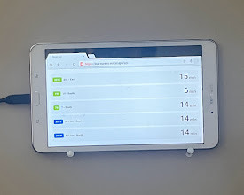

# Bus Screen

A tiny always-on display that shows how many minutes until the next Grand River Transit (GRT) buses leave nearby stops in Waterloo, Ontario.



It's a single Python serverless function on Vercel. An old tablet mounted by the door has the page open full-screen, and the page refreshes itself every 5 seconds.

## What it shows

| Badge  | Route           | Stop ID |
|--------|-----------------|---------|
| `201E` | 201 / 31 - East | 2512    |
| `19S`  | 19 - South      | 3623    |
| `7S`   | 7 - South       | 2509    |
| `301S` | 301 ION - South | 6004    |
| `301N` | 301 ION - North | 6120    |

Green badges are buses, and blue badges are the ION light rail. `--` means there are no more departures today.

## How it works

1. When it starts, and then every hour, `api/index.py` downloads GRT's public [GTFS feed](https://www.regionofwaterloo.ca/opendatadownloads/GRT_GTFS.zip).
2. It uses `calendar_dates.txt` to find today's service IDs, then keeps only the trips for each configured route and direction.
3. It takes the scheduled arrival times at each stop of interest from `stop_times.txt`.
4. On each request, it renders an HTML page with the minutes until the next arrival for each row.

These are **scheduled** times from the static GTFS feed, not live GPS positions.

## Project structure

```
api/index.py       # Vercel Python function: fetches GTFS, renders the page
vercel.json        # Redirects / to /api
requirements.txt   # Python dependencies
docs/              # Images for this README
```

## Customizing

Edit the `BUSES` list at the top of `api/index.py`:

```python
{'label': '19S', 'name': '19 - South', 'routes': [19], 'direction': 1, 'stop_id': 3623, 'ion': False},
```

- `routes`: one or more `route_id`s from `routes.txt`
- `direction`: the `direction_id` from `trips.txt` (`0` or `1`)
- `stop_id`: the stop to watch, from `stops.txt` (or GRT's stop-number signs)
- `ion`: `True` gives the row the blue ION badge

## Running locally

```bash
pip install -r requirements.txt
npm i -g vercel
vercel dev
```

Then open http://localhost:3000.

## Deploying

```bash
vercel --prod
```
